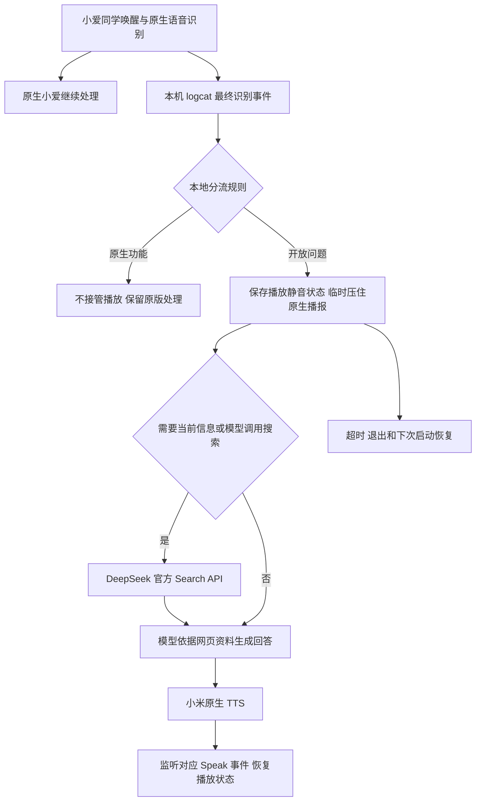

# 小爱触屏音箱 LX04 接入 DeepSeek：改造过程与修改技术报告

报告日期：2026-10-24（北京时间）。范围：从原厂设备识别、备份与启动调试，到音箱端自动分流、联网搜索及用户验收。

## 1. 结论与交付边界

本次在一台中国版小爱触屏音箱 LX04、原厂固件 2.42.118 上完成了 DeepSeek 接入。最终程序、账号配置、语音事件监听和启动脚本均驻留音箱，Mac 仅用于安装与维护，不承担日常后台服务。大模型推理和网页搜索仍调用 DeepSeek 云端，未在音箱中部署完整离线大模型。

用户仍用“小爱同学”唤醒，直接提问，不需要额外前缀。天气、结合天气的穿衣建议、家居控制、音乐及闹钟等优先保留原生处理；开放知识问题调用 DeepSeek；涉及当前信息时增加网页搜索。用户在最终语音测试后确认“都正常，比较满意”。

这里的“自动分流”包含两个不同机制：

- **原生功能与 DeepSeek 之间**：使用音箱本地规则判断，不是另一个通用意图分类模型。
- **DeepSeek 是否需要搜索**：明确的时效问题先搜索，其他问题允许模型通过 `web_search` 工具自行请求搜索。

本报告基于操作记录、当前源码、构建清单和用户反馈编写，不把中间候选镜像、测试意图或单次启动结果当成全部完成。可追溯的非机密摘要见 [验证与构建摘要](验证与构建摘要.json)；原始时间顺序见 [实机操作记录](实机操作记录.md)。

## 2. 设备与约束

| 项目 | 本次确认结果 |
| --- | --- |
| 型号 | 中国版 LX04 小爱触屏音箱 |
| 原厂固件 | 2.42.118 |
| SoC | MediaTek MT8167，Cortex-A35 |
| 系统与用户态 | Android 8.1，SDK 27，ARMv7 / armeabi-v7a |
| 实际运行内核 | Linux 4.4.95+，armv7l，以实机读取为准 |
| 内存 | 约 1 GB；客户端进程 RSS 的已测快照约 16–20 MiB，不代表长期峰值 |
| 数据分区 | 加密映射 `/dev/block/dm-1`；早期读取约 1.1 GB、可用约 722 MB，属于当时快照 |
| 最终启动槽 | B 槽，`ro.boot.slot_suffix=_b` |
| 安装/维护主机 | Apple Silicon Mac，全流程没有迁移 Windows |

用户要求逐步明确为：保留原版基本功能；程序不迁往 NAS 或常开 Mac；允许在已备份前提下试装调试启动镜像，失败时尝试恢复原厂；最后进一步要求取消“请问”前缀，并增加联网搜索。

原厂系统、设备绑定和已有语音链路应尽量保留。因此没有采用其他型号固件、国际版转换、替换整套 ROM 或重新实现麦克风识别链路的方案。

## 3. 最终架构



**这是旁路增强，不是阻断原生 NLP 的协议代理。** 原版小爱仍可处理同一条语音；程序从本机日志读取识别结果，决定是否叠加 DeepSeek，并通过播放静音控制减少原生抢答。它没有替换原生家居指令执行引擎，也没有将模型工具连接到家居操作接口。

“本机读取 ASR”表示在音箱读取原生识别结果，不表示语音识别模型完全离线运行。DeepSeek 回答通过原生 TTS 播报，也不等于已经把回答文字渲染到原厂屏幕界面。

## 4. 过程一：调研与初始识别

最初评估了 xiaogpt、MiGPT、xiaobot 和 Open-XiaoAI：

| 方案 | 与本次任务的关系 |
| --- | --- |
| xiaogpt | 有 LX04 配置及原生 TTS 接入经验，可作为云端对话记录方案参考 |
| MiGPT | 有 LX04 兼容性经验，但本次调研时已归档，未选为交付基础 |
| xiaobot | Go 实现，便于交叉编译为音箱可执行的静态 ARMv7 程序；最终复用其小米服务与模型客户端代码 |
| Open-XiaoAI | 当时核对的主要支持型号为 LX06/OH2P，不能据此向 LX04 刷入对应镜像 |

早期曾考虑 Mac/NAS 读取小米对话记录再转发模型。用户明确要求程序在音箱后，这一路线只保留为调研记录，不再作为部署目标。最终也没有启用 xiaobot 会影响既有功能的网络监控触发模式。

音箱正常连接 Mac 时，USB 为 `18d1:2d00`，只出现 Android Accessory 接口，ADB 和 fastboot 均没有设备。这个结果说明当时没有调试入口，不能据此判断硬件损坏或永久不可改造。

## 5. 过程二：打通只读访问并完成备份

### 5.1 macOS USB 兼容问题

使用固定提交的 mtkclient 与独立 Python 环境。按音量＋上电后，设备进入 `0e8d:0003` 的 BROM 模式，确认芯片代码为 `0x8167`。

初始安全配置读到 SBC、DAA 等启用。这些配置标志不等于已解锁。后续通过临时运行的 XFlash DA 获取读取能力，早期操作没有先写启动锁或格式化。

主机端遇到三类问题：

1. libusb 加载路径及工具新版 VID/PID 参数形式不兼容。
2. macOS 下 CDC 控制接口 0 无法正常 claim，导致 Kamakiri2 控制请求报错；局部跳过控制接口 claim 后，只读请求成功，数据接口仍按原流程处理。
3. DA 自动提速后 USB PID 切换影响重连筛选；用 `--noreconnect` 及单独的临时提速/重连检查规避，并比较提速前后的 GPT 数据。

兼容修改保存在 [mtkclient-macos.patch](mtkclient-macos.patch)。这部分是电脑工具修改，不是音箱固件补丁；也未安装 macFUSE 或修改 macOS 启动安全设置。

### 5.2 备份范围与证据

读取 27 个 GPT 分区，先备份关键分区，再完成 eMMC 物理区域备份：

| 备份 | 字节数 | 验证方式 |
| --- | ---: | --- |
| eMMC USER 全区 | 3,959,422,976（`0xec000000`） | 长度、SHA-256、GPT CRC、与六份关键分区副本比对 |
| BOOT1 | 2,097,152 | 长度与 SHA-256 |
| BOOT2 | 2,097,152 | 长度与 SHA-256 |
| boot_a、boot_b | 各 16,777,216 | 独立副本与全 USER 中相同范围一致 |
| seccfg、para、proinfo、nvram | 各自分区完整范围 | 长度、SHA-256、全区对应内容比对 |

完整备份保留在本机 `backups/`，不进入 Git。**RPMB 没有备份，也没有写入。** 备份完成及校验通过后，才推进实际试装。

## 6. 过程三：启动锁与 B 槽调试镜像

### 6.1 原件校验和写入边界

读取启动元数据确认 A 优先级 6、B 优先级 7，两槽均标记成功，原机当时优先启动 B。

seccfg 使用 mtkclient 的解析/硬件密码运算路径核验，清单记录实际算法类型为 V3。原件锁状态为 1，候选为 3；候选重新计算为锁定数据时，可重建原始头部。**这是候选数据计算的往返校验，不是先在设备反复上锁解锁。**

用户明确批准试装后，实际 raw flash 写入限制为：

| 区域 | 地址 | 实际写入量 |
| --- | --- | ---: |
| boot_b | `0x05dc0000` | 16 MiB，后续 V2–V6 也只替换此槽 |
| seccfg | `0x04c80000` | 第一个 512 字节扇区；随后读取完整分区比较 |

没有 raw 写入 boot_a、system、vendor、userdata、para 或 RPMB，没有格式化。这里“未 raw 写 userdata”不表示用户数据区从未变化：后续安装程序、配置、令牌及持久 USB 设置均产生了正常文件系统写入。

写入脚本对允许的地址与长度做白名单检查；写前检查原件、候选散列与 GPT，写后读回验证。失败分支尝试恢复原厂 boot_b 与 seccfg；模拟验证覆盖了中断与越界拒绝。没有因为备份存在而声称一定能恢复全部加密或绑定状态。

### 6.2 启动修改内容

基于本机原始启动镜像，使用 Magisk 30.7 脚本制作候选。为使 legacy system-as-root 路径运行 ramdisk，内核只实施 `skip_initramfs\0` → `want_initramfs\0` 的等长标记修改，并核验其他内核内容。保留原始启动头、命令行、加密和 verity 配置；保持 `ro.adb.secure=1`。

同时在 ramdisk overlay 中加入 ADB 初始化规则、原厂公钥与本机 ADB 公钥。没有复制 Mac 的 ADB 私钥到音箱。

### 6.3 V1–V6 迭代记录

| 版本 | 主要修改/假设 | 实机结果与结论 |
| --- | --- | --- |
| V1 | 启动完成后切换 USB ADB，初始 Magisk 调试镜像 | 能进入原厂桌面，但仍为原 Accessory USB。启动完成后的设置时机不足以让框架保持 ADB |
| V2 | 将持久 USB ADB 设置提前到 post-fs-data，完成后同步全局 adb_enabled | 出现 `0e8d:201c`，ADB 为 unauthorized，证明接口已开放，但认证尚未解决 |
| V3 | 向通用 Android 路径 `/data/misc/adb/adb_keys` 追加本机公钥 | 未解决认证；后来从原厂 adbd 二进制确认该 ROM 不使用此路径 |
| V4 | 尝试用 init 原生命令处理同一数据目录授权文件 | 曾写入，但在启动验证前被 V5 替换；不能列为已实测可用版本 |
| V5 | 将合并公钥文件 bind mount 到 `/adb_keys`，加入 `0x0501` 标记 | 标记证明 init 规则执行，认证仍未通过；当时证据不足以将失败归为唯一原因 |
| V6 | init 启动独立 Magisk-domain oneshot 服务，挂载并校验根目录公钥，按结果发布诊断标记后重新枚举 USB | `0x0601`、ADB authenticated、root、B 槽启动均得到实机确认，成为最终启动版本 |

关键固件差异来自对原厂 `/system/bin/adbd` ELF 的检查：认证 key_paths 只有 `/adb_keys` 和空终止项，而不是通用的数据目录授权路径。原厂 MiSystemUI 也没有找到常见 USB 调试授权 Activity，因此不能反复等待一个实际未提供的授权弹窗。

V6 保留三条原厂公钥，只加入当前 Mac 公钥；身份验证未关闭，网络 ADB 端口为 `-1`。其诊断值区分规则已执行、源文件不可读、挂载失败和公钥缺失，避免仅凭“USB 出现了”判断成功。

### 6.4 Mac 上的 O+Connect 抢占

认证排障还受到主机后台服务影响。O+Connect 的 root launchd 服务 `com.oplus.dsp.core` 带 KeepAlive，反复创建其自带 ADB 并占用 USB。只关 GUI 或停止一次 ADB 不足以释放接口；本任务的独立 ADB 曾报告 `e00002c5`。

使用官方 Platform-Tools 37.0.1 和独立端口 5038 后，仍须释放 USB 占用。用户最终在自己的终端执行 `launchctl bootout system/com.oplus.dsp.core`，停止该次系统会话中的服务；没有删除其 plist 或设置持久禁用。这个主机问题不能误判为音箱刷坏或授权文件一定错误。

## 7. 过程四：音箱端联网与账号接入

### 7.1 ARMv7 程序与网络环境

xiaobot 基础代码固定在提交 `7c98861a48437fcb74ea6483ff365b1e63d7ab1c`，ninego 固定在 `a4c59c1576bd1eb6c5d80684ad25abd103cf6331`。最终入口为新增的 `cmd/lx04-agent`，以 Go 1.27.3、`CGO_ENABLED=0 GOOS=linux GOARCH=arm GOARM=7` 构建。

直接搬到 Android 后发现：纯 Go DNS 不能依靠不存在的标准 resolv.conf。增加进程专属 resolver，使用本机网络中已验证的路由器 DNS，不修改原厂系统 DNS。HTTPS 使用 `/system/etc/security/cacerts`，并修正上游模型客户端跳过证书验证的问题，要求 TLS ≥ 1.2。

音箱直接请求 DeepSeek 模型列表及短对话，均返回 HTTP 200。随后选用实际可用的 `deepseek-flash`，关闭思考模式，控制语音回答长度。模型名称及能力以当日接口验证为依据。

### 7.2 小米登录和设备匹配

账号、密码和 Key 使用私密文件传入，不放入启动命令行或 Git。初始化按硬件型号及本机已知序列号/MAC 精确匹配云端设备，再保存 Miot DID；禁止配置 DID 不匹配时退选另一台同型号音箱。

登录适配中解决了以下问题：

- 登录 `code=0` 但仍带通知验证地址，不能直接当成已经拿齐登录凭据。
- `/identity/list` 的 `code=2` 可以是合法的手机号验证方式列表，不能套用所有接口只认 code=0 的逻辑。
- 短信验证成功后的跳转可能到尚未追加签名的 STS 并返回 HTTP 401；账号 cookie 已生效，继续 serviceLogin 才能完成服务令牌交换。不能仅凭最后一个 HTTP 状态要求不断重发验证码。
- 不同小米 SID 的 serviceToken 不能混用；API 请求使用指定 SID 的显式 cookie，避免登录 cookie jar 混入另一个服务的令牌。
- 续期保留已验证的 passToken，临时网络或 TLS 失败不再清空整份已验证身份。

验证码、临时认证会话和请求跟踪在接入完成后清理。正式凭证及令牌文件权限 0600，私密目录权限 0700。

## 8. 过程五：从云端轮询改为本机识别事件

第一版应用读取小米云端对话记录，只对“请问”开头的问题调用模型。虽然已经生成唐诗问题的新回答，但用户听到原版小爱先说“不知道”等内容；同时云端轮询出现过 code 999。这说明“模型答了”不等于“语音交互已经满足要求”。

用户进一步要求无前缀自动判断，最终放弃对话记录轮询作为语音入口。实机日志提供两个可用来源：

| 来源 | 事件 | 处理 |
| --- | --- | --- |
| `MICO.cap` | `SpeechRecognizer.RecognizeResult` | 仅接收 `is_final=true` 的文本，忽略中间识别结果 |
| `MICO.speech` | `MSG_ASR_FINAL_RESULT` | 作为同一最终文本的另一来源 |
| `MICO.cap` | `SpeechSynthesizer.Speak` | 匹配本轮待播报回答，恢复音频 |

最终 agent 在音箱本机启动 logcat，从启动时刻开始监听，避免回放陈旧事件；相同文本两秒内去重。新问题增加代次并取消旧模型请求，避免旧回答恢复新一轮的音频状态。

### 8.1 自动分流与“穿衣建议”修正

本地规则先识别原生场景，其余问题默认调用模型。不能只依靠“天气”两个字：“明天穿什么衣服”依赖本地实时预报，如果交给通用模型，模型只能给出脱离天气的建议。

因此增加时间/出门语境与穿衣、短袖、外套、带伞、晾晒、洗车等词的组合规则，同时保留“古代唐朝人穿什么衣服”等知识问题走模型。用户对修正后的穿衣与知识问答进行了实际确认。

规则是保守的功能保留策略，仍可能误判未覆盖的说法，并非所有问题都能被准确理解。

### 8.2 原生抢答与声音恢复

本机事件比云端对话轮询更早，但原生 NLP 仍会继续运行。最终在需要 DeepSeek 时保存主播放静音状态，再临时静音，收到该轮回答的 Speak 指令时恢复；不会把音量值改成零。

正式程序使用的是针对本机 Android 8.1 核对过的 `IAudioService` 主播放静音接口。若收不到对应 Speak，TTS 请求被接受后还有一秒回退恢复；另有 25 秒请求看门狗、退出处理、启动恢复及启动脚本退出恢复。快照文件 `.audio-restore.json` 权限 0600，恢复后删除。

接口探索时曾误调用一次麦克风静音接口，已立即恢复并向用户说明。正式程序没有调用该麦克风接口。这个教训说明 Binder transaction 编号不能凭其他 Android 版本经验直接照搬；当前音频控制也不能宣称适用于所有机型或系统版本。

## 9. 过程六：开机自启动的真实验证

仅把脚本放入 service.d 后，第一次 ADB 重启并未自动运行。旧 PID 文件和旧日志还在，因此没有据此报告成功。`/cache/magisk.log` 明确记录 `Magisk environment incomplete, abort`，而 `/data/adb/magisk` 为空。

检查同版 Magisk 源码后，确认缺少 busybox 会让环境初始化提前退出。随后从同一官方 Magisk 30.7 APK 提取 ARMv7 busybox、magisk、magiskboot、magiskinit、magiskpolicy 及配套脚本/stub，补入数据目录，共约 2.8 MB；没有再次刷写启动分区。

第二次 ADB 重启得到完整证据链：

1. boot_id 改变，Android `sys.boot_completed=1`。
2. Magisk 日志进入 post-fs-data 和 late_start，并明确执行 `service.d: exec [lx04-deepseek.sh]`。
3. 客户端由开机流程自行产生新 PID，21:18:04 输出 ready；此时没有从 Mac 手动启动客户端。
4. 用户再次验证穿衣建议与知识问答，确认正常。

正式启动脚本等待 Android 启动完成和网络路由就绪，设置私有 HOME、DNS 与 CA 路径，禁止重复启动并保存 PID。它不是完整的进程监管器：程序异常退出后会尝试恢复声音，但没有无限自动重启循环。

## 10. 过程七：接入官方联网搜索

纯对话 API 调用不自动等于有网页搜索。用户提出查询“现在排名高的大模型”时，检查当日官方文档后确认可调用 DeepSeek 的 `POST https://api.deepseek.com/v1/tools/search`，复用现有 Key。

新增搜索客户端和问答编排层：

- “最新、目前、排名、新闻、价格”等明确时效问题预先搜索；其他问题向模型提供 web_search 函数工具。
- 每个问题最多两次搜索，最多三轮模型请求；搜索最多取五条结果，限制搜索词 Unicode 长度和响应大小，并设独立超时。
- 将标题、链接、摘要、日期作为工具资料交给模型，注入当日日期；要求区分事实、时间和来源。
- 空结果或搜索失败不调用模型编造最新信息，而是给出明确的失败反馈。
- 不提供执行 shell、控制设备或任意账号操作工具；网页摘录是不可信资料，不能覆盖系统及用户指令。

最初的大模型排名检索混入人气榜、市场份额与 AI 搜索产品榜。修正检索词后，大模型能力排名优先查询 Artificial Analysis / Arena 原站，并要求回答区分榜单指标。未接入官方 Fetch 接口，也不把搜索摘要视作永远实时、正确的榜单数据库。

音箱端搜索与模型合成测试通过，部署到语音程序后用户再次确认“都正常，比较满意”。最近一次查询、时间及来源写入私密 `last-search.json`，以便追溯。

搜索调用有单独的官方计费规则，见 [DeepSeek Search & Fetch](https://api-docs.deepseek.com/guides/search/)。本次查询时独立 Search API 标价每 1,000 次成功请求 0.75 美元，另加模型费用；这不是本地离线搜索或永久免费承诺。

## 11. 最终修改清单

| 层级 | 最终变化 | 保留范围 |
| --- | --- | --- |
| 原始启动区域 | boot_b 为 V6 调试启动镜像；seccfg 锁状态按批准的候选修改 | boot_a、system、vendor、para、RPMB 未 raw 写入 |
| Android 调试 | 提前设置 USB ADB；本机公钥与原厂公钥合并授权 | ADB 校验开启，未开网络 ADB |
| Magisk 数据环境 | 补齐同版运行组件，安装 service.d 入口 | 无其他型号 ROM 替换 |
| 音箱应用目录 | `/data/adb/lx04-deepseek` 中的程序、配置、令牌及日志 | 原厂桌面、原生识别与家居执行链路保留 |
| 主机工具 | mtkclient macOS 兼容补丁，独立 ADB 5038，停止本次 O+Connect 后台占用 | 无需 Mac/NAS 提供日常模型服务 |

客户端完整源码见 [client](../client/)，相对固定上游的代码变更通过 [xiaobot-local.patch](xiaobot-local.patch) 保存，主要模块如下：

| 模块/文件 | 作用 |
| --- | --- |
| `cmd/lx04-agent` | 独立进程、事件监听、任务取消、音频与模型/搜索编排 |
| `devicevoice/events.go` | 最终识别解析、本地规则分流、适合 TTS 的文本整理 |
| `devicevoice/audio.go` | 本机主播放静音控制、原状态快照及恢复 |
| `runtimeenv/dns.go` | 进程专属 DNS 适配 |
| `deepseekweb/client.go` | 官方 Search API、认证、超时及结果边界 |
| `voiceanswer/answer.go` | 时效预搜索、模型工具循环、来源与成本上限 |
| `miservice/account.go`、`otp.go`、`token_store.go` | 小米登录、验证、SID 隔离与令牌保存 |
| `xiaomi.go` | 精确设备选择、原生 TTS 及机型兼容 |
| `jarvis/openai/client.go`、`types.go` | HTTPS 校验、超时与请求参数支持 |

保留了诊断与初始轮询阶段相关代码以追溯过程；最终运行入口是 `cmd/lx04-agent`，不应把旧 `cmd/xiaobot.go` 当成最终语音入口。

## 12. 验证与证据等级

| 验证项 | 证据与结论 |
| --- | --- |
| 原始备份一致性 | 完整 USER 长度/GPT/关键分区比对及散列通过 |
| 写入边界与恢复分支 | 地址长度白名单、写后读回；异常恢复有模拟验证，未在最终稳定状态执行整机原厂回退演练 |
| V6 与 root ADB | USB 0x0601、认证连接、root、B 槽均实测 |
| Android 安全状态 | 已测 SELinux Enforcing，ro.adb.secure=1，网络 ADB 关闭 |
| 凭证与网络 | 私密目录 0700，配置/令牌 0600；验证有效 TLS，不接受不可信测试证书 |
| 本机事件与分流 | 最终/中间 ASR 解析、原生场景与知识问题分流测试通过 |
| 无前缀语音问答 | 实机日志与用户实际听感确认 |
| 天气/穿衣 | 用户重启后确认正常；原生穿衣建议不再交给通用模型猜测 |
| 米家、音乐、闹钟 | 原生执行链路保留，有规则测试；未主动随机操作家电，未逐项穷举所有设备与功能 |
| 搜索 | 认证/长度/空结果/工具循环等测试通过；音箱直连官方接口及用户语音验收通过 |
| 开机自启 | 第二次重启有 Magisk 执行日志、新 PID 与 ready 记录；后续搜索版更新未改启动机制，并完成运行及语音验收 |
| 性能 | 彩虹、热量等简单问题曾记录模型生成约 1–1.5 秒，不含所有 TTS 延迟；不是所有问题或搜索请求的延迟保证 |

最后一次实现阶段验证的测试覆盖 DNS、TLS、小米认证、自动分流、搜索和问答编排。没有把这些局部测试表述为全仓覆盖率或所有异常场景已证明。

最终语音程序大小为 19,726,496 字节，SHA-256：

```text
a92e50c7b63ba494a59c6bc12611c87c3947bf12cef693450779adbfa10c5343
```

V6 boot_b SHA-256：

```text
8db1b5d514a4d07649fc79a3ebdaf2ff50f31f1585a0a47c5caa107af6ee103e
```

这是已部署版本的识别信息。本次报告整理不重新编译替换该程序、不刷写音箱；以后工具链改变时，新构建应重新记录自己的散列。

本次整理重新核对了本地客户端和源码补丁的散列与既有构建清单。备份散列来自此前已校验的原始清单，没有为编写报告重新读取音箱或重算全部多 GB 镜像。

## 13. 已知限制与维护边界

1. **网络与云账号依赖**：依赖小米识别/TTS及 DeepSeek 服务；程序本机运行不代表完全离线。接口和账号验证变化可能需要维护。
2. **规则覆盖有限**：新的中文说法、场景名或复合要求可能误分流。音频旁路不等于拦截所有原生执行行为。
3. **系统针对性**：音频 Binder 编号和日志格式只在本机 Android 8.1 验证。固件变化或日志被关闭会影响接入。
4. **网络适配**：原机部署时 DNS 与路由等待地址固定为本次路由器。公开模板已改为私密 DNS 文件及网络路由检测；公开版需按自己的网络配置，尚未在第二台机器实测。
5. **不是完整对话助手**：最终引擎每问新建消息，不保存多轮上下文，也没有免唤醒连续收音；回答播报前最多保留约 240 个字符，过长内容会被截短。
6. **音频控制为主播放静音**：不是仅隔离原生 TTS 音轨。接管期间其他播放也可能被暂时压住；SIGKILL、断电等场景不保证退出处理一定执行，仍依靠保存状态及后续恢复入口。
7. **进程与日志管理有限**：没有完整崩溃自重启监管；日志在启动时保留当前/上次两份，未实现按文件大小轮转。日志及搜索文件包含用户提问和回答，应保留在私密目录。
8. **原厂恢复范围有限**：回写启动镜像与启动锁不自动撤销所有持久 USB 设置、程序文件与登录状态；RPMB 不在备份内。恢复方案不等于保证所有状态可逆。
9. **验证时间有限**：完成单机功能验收，没有长时间老化、多账户、多机型或完整米家设备矩阵测试。

日常暂停程序及音频恢复方法见 [使用与维护](使用与维护.md)。完整启动恢复应结合原始备份与专用脚本检查，不能把本报告的地址或镜像用于其他设备。

## 14. 仓库与可复现性

原先的本地首次提交冻结了工程完成时的文档与脚本，未伪造 V1–V6 的逐次 Git 历史。对外公开前，将该本地历史单独留档，并从脱敏后的源码快照建立公开历史；阶段过程仍由操作记录与清单追溯。

公开仓库包含 `client/` 完整源码、所需 ninego 本地模块、全部启动/维护实现、工具修改补丁、示例、测试及 CI。账号、令牌、设备序列号/MAC、ADB 密钥、原厂备份、候选镜像、下载工具和原始日志不发布，本机原件继续保留。

公开整理将 bootstrap 的实机标识改为 `-device-file` 私密选择文件，将启动 DNS 改为可配置；新增相应设备匹配测试，保留已有实现。`client/go.mod` 指向仓库内的本地依赖。公开补丁也已脱敏重建，它与历史部署补丁不再具有相同散列。第 12 节的二进制散列仅用于识别原机验收版本，不能拿来校验公开源码的新构建。

构建/测试见根目录 [README](../README.md)，部署见[部署指南](部署指南.md)。源码许可、保留署名与组件范围见 [THIRD_PARTY](../THIRD_PARTY.md)。克隆公开仓库可以构建客户端，但不会获得原厂镜像和设备私密资料；底层脚本仍保留本次实机的地址和散列边界。

## 15. 主要参考

- [xiaobot](https://github.com/axcom/xiaobot)、[ninego](https://github.com/axcom/ninego)：本次客户端基础代码，固定提交见验证摘要。
- [mtkclient](https://github.com/bkerler/mtkclient)：BROM/DA、读取、启动配置操作基础工具。
- [Magisk 30.7](https://github.com/topjohnwu/Magisk/tree/v30.7)、[启动阶段实现](https://github.com/topjohnwu/Magisk/blob/v30.7/native/src/core/bootstages.rs)：ramdisk、运行环境与 service.d 排障依据。
- [Android 8.1 IAudioService](https://github.com/aosp-mirror/platform_frameworks_base/blob/android-8.1.0_r1/media/java/android/media/IAudioService.aidl)：音频接口核对参考，最终仍以本机调用结果为准。
- [DeepSeek Search & Fetch](https://api-docs.deepseek.com/guides/search/)、[Tool Calls](https://api-docs.deepseek.com/guides/tool_calls/)：官方搜索与模型工具协议。
- [前期调研与接入建议](调研与接入建议.md)：保留当时方案选择和资料，不代表最终架构仍需 Mac 服务或“请问”前缀。
